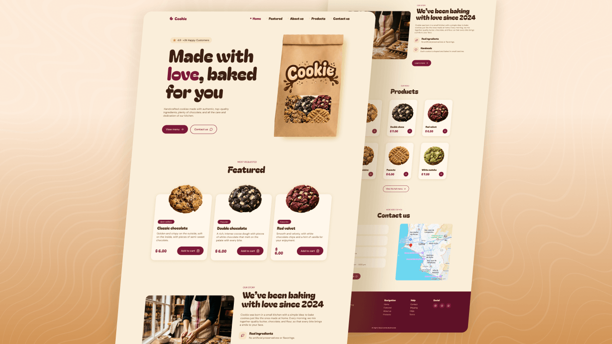

# Responsive Cookies Website

This project is part of a step-by-step YouTube tutorial in which we build a responsive cookies website from scratch using HTML, CSS and JavaScript with mobile first

 

### 📌 Project Features
- Responsive Cookies Website Using HTML CSS JavaScript | Mobile First
- Clear and semantic HTML structure.
- Use of CSS variables and modern JavaScript functions.
- Contains animations when scrolling.
- Smooth scrolling in each section.
- Includes interactive animations of cookies falling toward the bag.
- As you scroll, the cookies emerge from the bag and move toward the cards, creating a modern animation.
- Developed first with the Mobile First methodology, then for desktop.
- Compatible with all mobile devices and with a beautiful and pleasant user interface.

